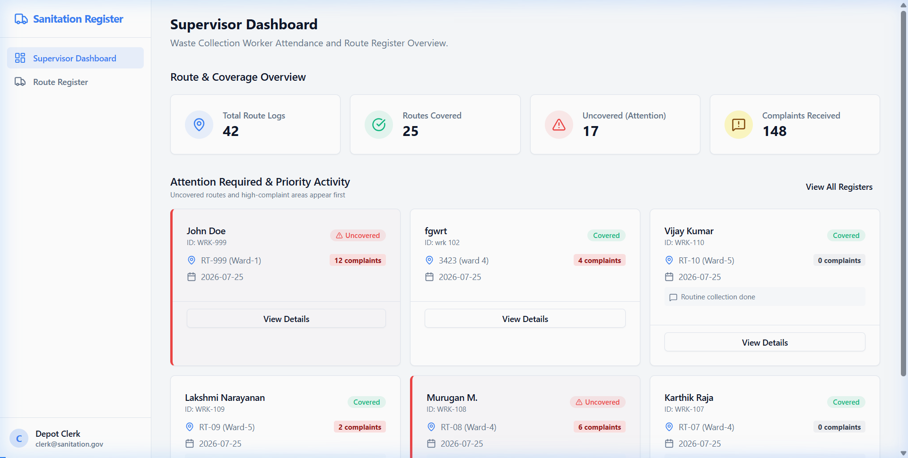
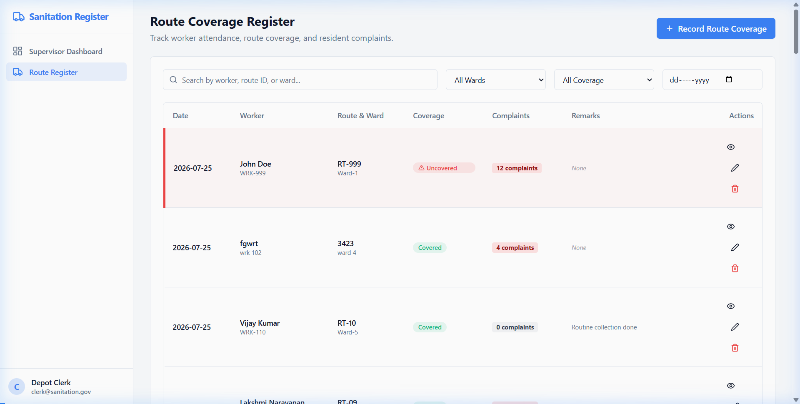
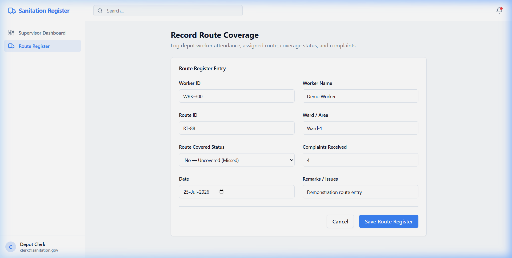
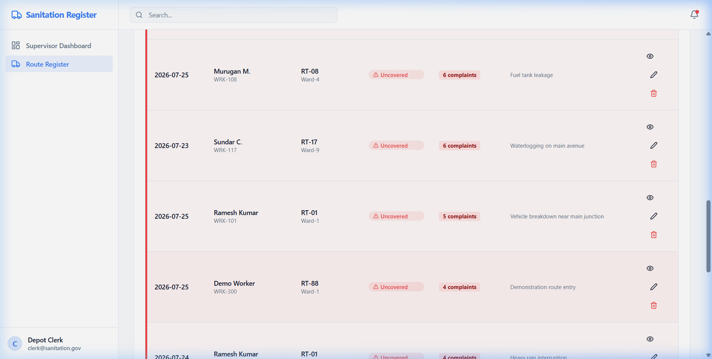

# Waste Collection Worker Attendance and Route Register
**SIH 2026 — Internal Practical Assessment Solution**  
*Student: Noorul Ahamed M | Reg: 411725205040 | PSVPEC IT | Year II*


---

## 📌 Problem Statement (Two Lines)
Sanitation workers are assigned to routes at the depot, but uncollected streets are only discovered via resident complaints because route coverage was previously unrecorded. This application provides a daily digital register that connects worker attendance, route coverage, and resident complaints so supervisors immediately know which routes were missed and need priority attention.

---

## 📖 Field Dictionary & Specifications

| Field Name | Type | Description | Allowed / Valid Values |
| :--- | :--- | :--- | :--- |
| `id` / `record_id` | Integer (PK) | Auto-incrementing unique identifier for each register log. | Positive integers (`1, 2, 3...`) |
| `date` | String | The date when the route coverage was recorded. | `YYYY-MM-DD` (Cannot be in the future) |
| `worker_id` | String | Unique identification code of the sanitation worker. | e.g. `WRK-101`, `WRK-102` |
| `worker_name` | String | Full name of the sanitation worker. | Non-empty text |
| `route_id` | String | Unique identifier of the assigned sanitation route. | e.g. `RT-01`, `RT-02` |
| `ward` | String | Municipal ward or administrative area. | e.g. `Ward-1` through `Ward-10` |
| `covered` | String (Enum) | Indicates whether the assigned route was fully covered that day. | `'Yes'`, `'No'` |
| `complaints_received` | Integer | Total number of resident complaints received for this route on that date. | Non-negative integers (`>= 0`) |
| `remarks` | String | Optional notes by depot clerk (e.g. breakdown, rain, road block). | Text string (Can be empty) |

---

## 🧮 Derived Figures & Formulas

1. **Uncovered Routes Count (Attention Required)**:
   $$\text{Uncovered Count} = \sum \text{records where } \text{covered} = \text{'No'}$$

2. **Route Coverage Rate (%)**:
   $$\text{Coverage Rate} = \left( \frac{\text{Total Covered Records ('Yes')}}{\text{Total Records}} \right) \times 100$$

3. **Total Resident Complaints**:
   $$\text{Total Complaints} = \sum \text{complaints\_received}$$

4. **Attention Priority Order (Task 3 Logic)**:
   Records are automatically ordered by the backend database query so that **uncovered routes appear at the top**, sorted by highest number of complaints:
   ```sql
   ORDER BY CASE WHEN covered = 'No' THEN 0 ELSE 1 END, complaints_received DESC, date DESC
   ```

5. **Hand-Calculated Figure Verification (Task 5)**:
   - Initial seeded dataset: **40 records** (26 Covered, 14 Uncovered, 150 Complaints).
   - Coverage Rate % = $(26 / 40) \times 100 = 65.0\%$.
   - After adding test record `WRK-300` (Uncovered, 4 complaints): **41 records** (26 Covered, 15 Uncovered, 154 Complaints).

---

## 🛠️ Step-by-Step Instructions to Run the Application

### Prerequisites
- Node.js (v18+ recommended)
- npm

### 1. Install Dependencies
```bash
npm install
cd client && npm install && cd ..
```

### 2. Run Automated Test Suite (20/20 Tests Passed)
```bash
npm test
```

### 3. Run Backend Server (Express + SQLite)
```bash
npm run dev
# or
node server/server.js
```
*Note: SQLite database initializes at `database/app.db` and automatically seeds **40 realistic sample records** (including awkward edge cases like missing remarks, similar names "Ramesh Kumar" vs "Ramesh Kumar V.", and unlinked records).*

### 4. Run React Frontend (Vite + Tailwind)
```bash
npm run dev:client
```
Open your browser at `http://localhost:5173`.

---

## 📷 Screenshots & Video Demonstration

### 📹 Full Application End-to-End Walkthrough


### 📊 1. Supervisor Dashboard & Priority Attention Cards


### 📋 2. Route Coverage Register (Sorted by Attention Priority)


### 📝 3. Record Route Coverage Form (Client & Server Zod Validation)


### ✅ 4. New Record Created & Live Dashboard Metrics Update


---

## 🧪 Deliberate Awkward Cases in Sample Data (Task 1)

1. **Similar Worker Names**: `Ramesh Kumar` (WRK-101) and `Ramesh Kumar V.` (WRK-102), as well as `Suresh K.` (WRK-103) and `Suresh Kumar` (WRK-104) test search precision.
2. **Missing Field Value**: Records like WRK-106 have blank `remarks` to verify graceful UI fallback (`None`).
3. **Isolated/Unlinked Record**: WRK-199 on `RT-99` in `Ward-99` has 0 complaints and tests boundary search/filters.

---

## 📋 What Is Not Finished / Remaining Improvements
- Multi-depot authentication and role-based permissions (clerk vs supervisor login JWT).
- Automated SMS/Push notifications sent to workers when a route is marked uncovered.
